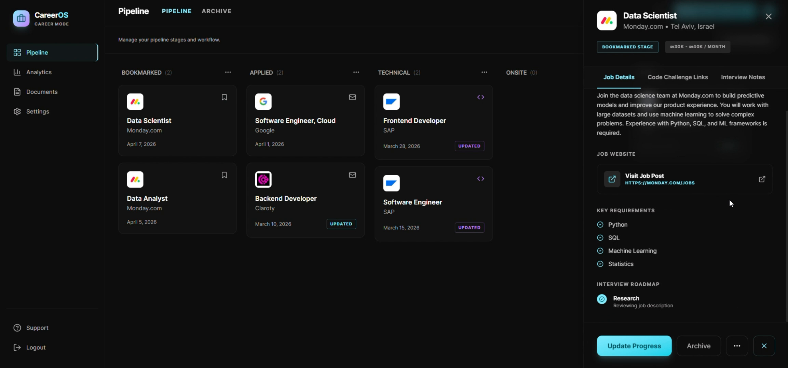
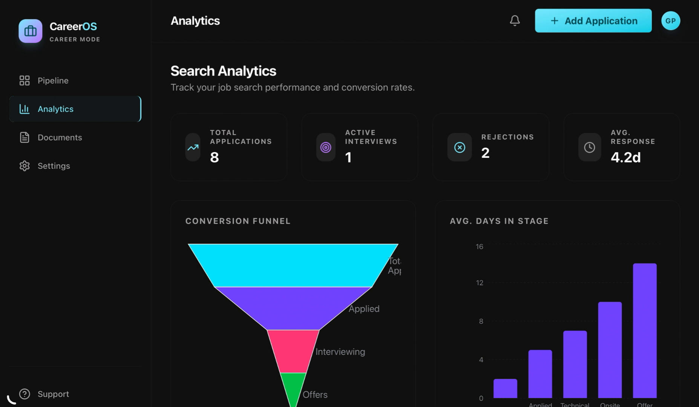

# Job Application Tracker

A modern job application tracker that helps you organize your job search with a Kanban-style pipeline, AI auto-fill from job postings, an analytics dashboard, and a document vault.

Built with React 19, TypeScript, Vite, Tailwind CSS, Express, Firebase, and Google Gemini.

**Live app:** [job-application-tracker-6293.ai.studio](https://job-application-tracker-6293.ai.studio/)

## Screenshots

<!-- Add your screenshots below. Drop image files in a `docs/` or `assets/` folder and reference them here. -->

| Kanban Pipeline | Analytics Dashboard |
| --- | --- |
|  |  |

## Features

- **Kanban Pipeline** — Drag-and-drop board to move applications through customizable stages (Referral Requested, Applied, Screening Call, Home Assignment, Technical Interview, HR Interview, Offer).
- **AI Auto-fill** — Paste a job posting link (or its text, for sites like LinkedIn that block fetching) and Gemini fills in the title, company, location, salary, requirements, and a short summary.
- **Referral Contact** — Record who you applied through (name and contact details), shown on the card and in the job details.
- **Customizable Columns** — Add, rename, reorder, and delete pipeline columns to match your workflow.
- **Analytics Dashboard** — Visualize your pipeline funnel, application velocity, and offer rate with interactive charts.
- **Document Vault** — Store resumes, cover letters, and other assets per application.
- **Quick Links** — One-click access to your most-used job boards and resources.
- **Notifications** — Follow-up and interview reminders.
- **Cloud Sync** — Real-time sync across devices via Firebase Firestore.
- **Secure Sign-In** — Google sign-in plus email/password authentication out of the box.
- **Demo Data** — Load a sample profile and 8 example applications to explore the app instantly.

## Tech Stack

| Layer | Technology |
| --- | --- |
| Frontend | React 19, TypeScript, Vite 6 |
| Styling | Tailwind CSS 4 |
| Drag & Drop | `@hello-pangea/dnd` |
| Animations | Motion |
| Charts | Recharts |
| Icons | Lucide |
| Backend | Express (serves the app and the `/api/extract-job` endpoint) |
| AI | Google Gemini (`@google/genai`) with the URL context tool |
| Auth & Database | Firebase Authentication, Cloud Firestore |

## Getting Started

### Prerequisites

- [Node.js](https://nodejs.org/) 18 or newer
- A [Firebase](https://firebase.google.com/) project (with Authentication and Firestore enabled)
- A [Gemini API key](https://aistudio.google.com/apikey) for AI auto-fill (the free tier is enough)

### Installation

```bash
git clone <your-repo-url>
cd Job-Application-Tracker
npm install
```

### Configuration

1. Copy the example environment file and fill in your own Firebase web app config:

   ```bash
   cp .env.example .env.local
   ```

   Then set the `VITE_FIREBASE_*` values in `.env.local` from your Firebase project settings (Project settings → General → Your apps → SDK setup), and set `GEMINI_API_KEY` to your Gemini API key. `.env.local` is git-ignored and must never be committed. The Gemini key is only read by the server and never reaches the browser.

2. Publish the Firestore security rules in [firestore.rules](firestore.rules) to your Firebase project, either with the Firebase CLI or by pasting them into Firebase Console → Firestore → (your database) → Rules:

   ```bash
   firebase deploy --only firestore:rules
   ```

3. In Firebase Console → Authentication → Settings → Authorized domains, make sure `localhost` and your deployed domain are listed, or Google sign-in will fail.

### Run Locally

```bash
npm run dev
```

This starts the Express server with Vite in middleware mode. The app will be available at [http://localhost:3000](http://localhost:3000).

### Build for Production

```bash
npm run build
NODE_ENV=production npm start
```

## Available Scripts

| Script | Description |
| --- | --- |
| `npm run dev` | Start the Express + Vite dev server on port 3000 |
| `npm run build` | Build the production bundle to `dist/` |
| `npm start` | Run the Express server (serves `dist/` when `NODE_ENV=production`) |
| `npm run preview` | Preview the static build only (no AI endpoint) |
| `npm run lint` | Type-check the project with TypeScript |
| `npm run clean` | Remove the `dist/` directory |

## Project Structure

```
.
├── src/
│   ├── components/        # React UI components (Kanban, modals, screens)
│   ├── constants/         # Default pipeline columns and mock/demo data
│   ├── lib/               # Utilities (error handling, helpers)
│   ├── services/          # Client for the AI job-extraction endpoint
│   ├── App.tsx            # Root component, state, Firestore wiring
│   ├── firebase.ts        # Firebase initialization (config from env vars)
│   ├── types.ts           # Shared TypeScript types
│   └── main.tsx           # Vite entry point
├── server.ts              # Express server: Gemini job extraction + serving the app
├── firestore.rules        # Firestore security rules
├── .env.example           # Template for Firebase config and Gemini key (copy to .env.local)
├── index.html             # Vite HTML entry
├── vite.config.ts
└── package.json
```

## Usage

1. **Sign in** with your Google account on the welcome screen.
2. **Add a job** with the "+" button in the top bar. Paste the posting link (or text) into **AI Auto-fill** to fill in the details, then add who you applied through.
3. **Drag cards** between columns as your applications progress.
4. **Click a card** to view full details, edit, add interview notes, attach documents, or archive.
5. **Customize your board** via the "Edit Board" action to rename, add, or remove columns.
6. **Track progress** in the Analytics tab and manage assets in the Documents tab.
7. **Load demo data** from Settings if you want a populated pipeline to explore.

## Deployment

The live app is deployed from Google AI Studio to Cloud Run. Because AI auto-fill runs on the Express server, the app needs a Node host (Cloud Run, Render, Fly.io, etc.), not a static host.

- Provide the `VITE_FIREBASE_*` values at **build time**, since Vite inlines them into the bundle.
- Provide `GEMINI_API_KEY` at **runtime** to the server, and run it with `NODE_ENV=production` so it serves `dist/`.
- Add the deployed domain to Firebase's Authorized domains.

## License

MIT
